<div align="center">

# RealReelz

**Turn one prompt into a narrated, captioned, animated vertical video. No face, no editor.**

[](https://github.com/lelianto/realreelz/actions/workflows/ci.yml)
[](LICENSE)

[](https://remotion.dev)

**English** · [Bahasa Indonesia](README.id.md)

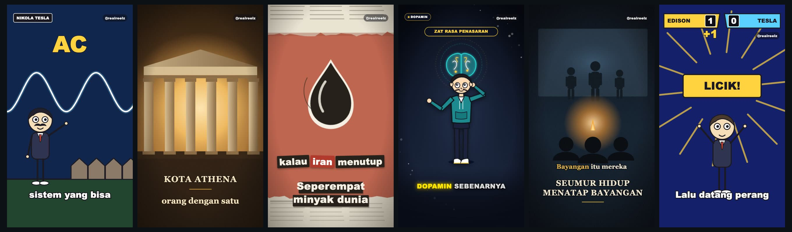

</div>

RealReelz is a faceless short-video generator for Reels, TikTok and Shorts,
built on [Remotion](https://remotion.dev). You write a topic (or a script), and
the pipeline produces a 1080×1920 MP4 with a natural voiceover, word-synced
karaoke captions and an animated template that cuts scenes on cue words in the
narration.

It was built for Indonesian-language channels, so voices and examples default
to Indonesian, but every piece (voice, captions, script language) is configurable.

## Features

- **Prompt to video.** A local web app (`npm run web`) sends your topic to the
  Claude API, gets back a script plus scene list, then voices, captions and
  renders it. About 2–5 minutes per video.
- **Free voice by default.** [edge-tts](https://github.com/rany2/edge-tts) neural
  voices with no API key. ElevenLabs and offline [Piper](https://github.com/rhasspy/piper) are optional.
- **Word-level captions** from [whisper.cpp](https://github.com/ggerganov/whisper.cpp),
  downloaded and built automatically on first run, with per-video fixes for misheard words.
- **14+ animated templates**, all drawn in code (SVG, DOM, Three.js): no stock
  footage or image generation required.
- **Cue-driven scenes.** Each scene starts when its trigger word is spoken, so
  visuals stay in sync with any voice or speed.
- **YouTube to Reels clipper.** Finds the most-replayed moment of a long video,
  crops it to 9:16 and adds karaoke captions (`npm run clip <url>`).
- **One JSON file per video.** Everything a video needs lives in `src/content.json`,
  easy to generate, diff and version.

## Quickstart

Requirements: Node.js 18+, Python 3, ffmpeg. Google Chrome is recommended on macOS.

```bash
git clone https://github.com/lelianto/realreelz.git
cd realreelz
npm install
python3 -m venv .venv && .venv/bin/pip install edge-tts
cp .env.example .env                              # set REMOTION_HANDLE=@yourhandle

cp src/content-stickman.json src/content.json     # pick an example video
npm run build:audio:edge                          # voiceover + captions
npm run render                                    # -> out/reel.mp4
```

Preview and tweak any template live in the browser with `npm run studio`.

### Prompt to video (web app)

Add `ANTHROPIC_API_KEY` to `.env`, then:

```bash
npm run web          # http://localhost:4000
```

Or generate the content file only, without the web UI:

```bash
npm run generate "Alan Turing, father of computer science"   # -> src/content.json
```

## Templates

Pick a template with the `"template"` field in the content JSON. Each one has at
least one example file in `src/content-*.json`.

| | | | |
|:-:|:-:|:-:|:-:|
| 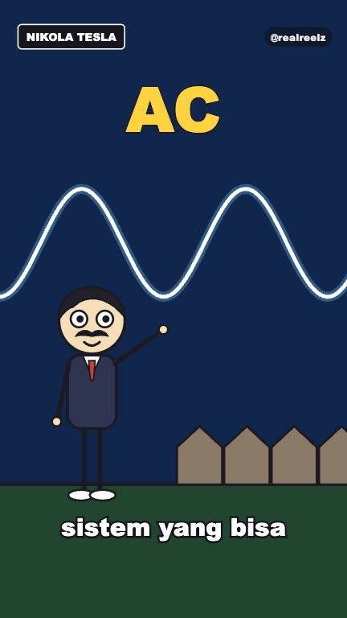<br>**stickman**<br><sub>biographies & concepts</sub> | 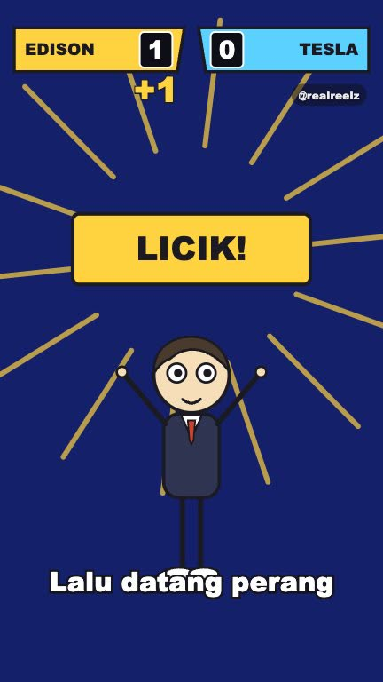<br>**stickman · duel**<br><sub>rivalry scoreboard</sub> | 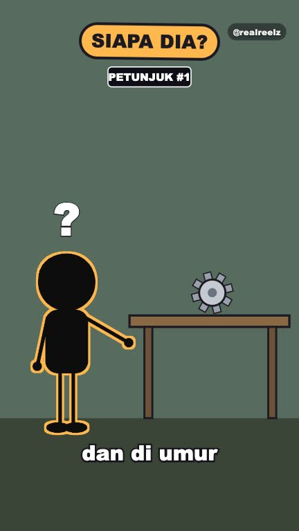<br>**stickman · tebak**<br><sub>guess-who reveal</sub> | 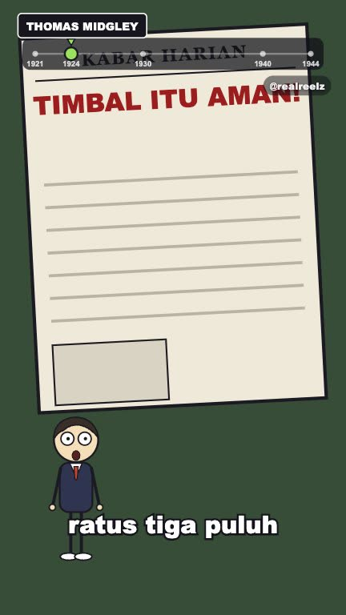<br>**stickman · mundur**<br><sub>countdown timeline</sub> |
| 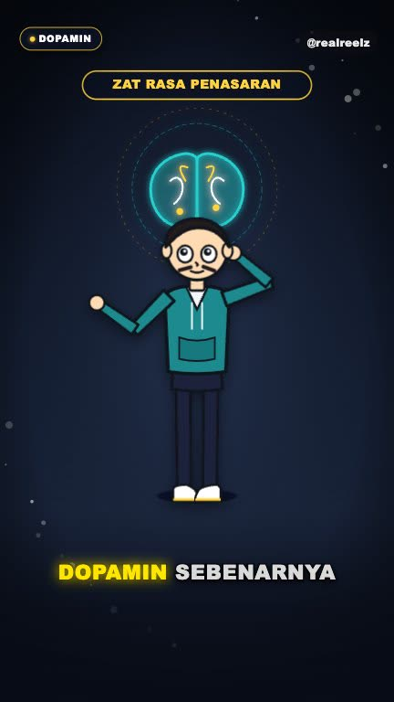<br>**explainer**<br><sub>vector explainer</sub> | 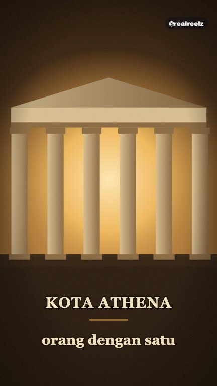<br>**chronicle**<br><sub>sepia history</sub> | 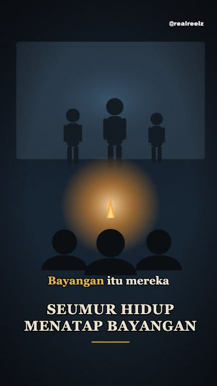<br>**parable**<br><sub>philosophy & fallacies</sub> | 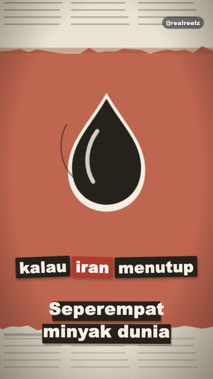<br>**collage**<br><sub>torn-paper documentary</sub> |
| 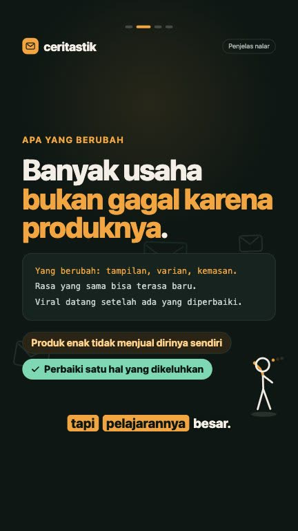<br>**storycard**<br><sub>text story cards</sub> | 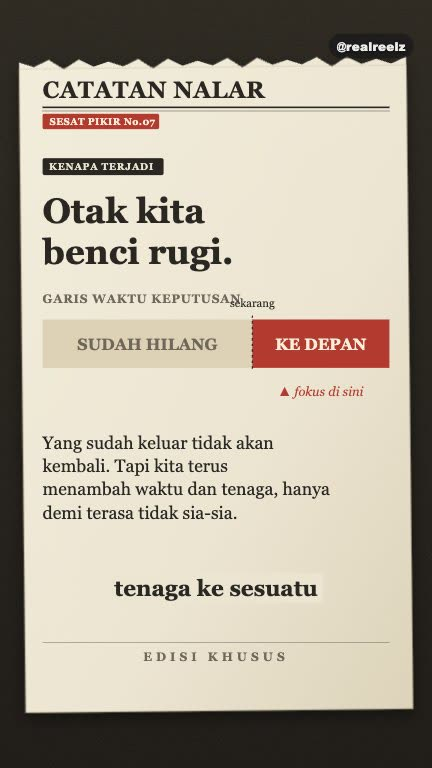<br>**fieldnotes**<br><sub>notebook concept</sub> | 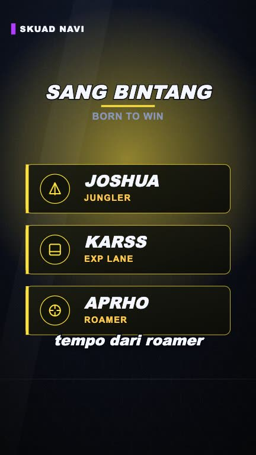<br>**esports**<br><sub>tournament recap</sub> | 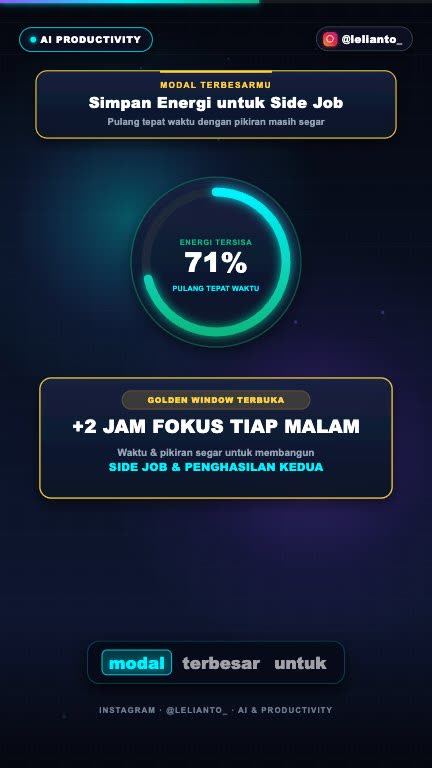<br>**ai-productivity**<br><sub>SaaS motion graphics</sub> |
| 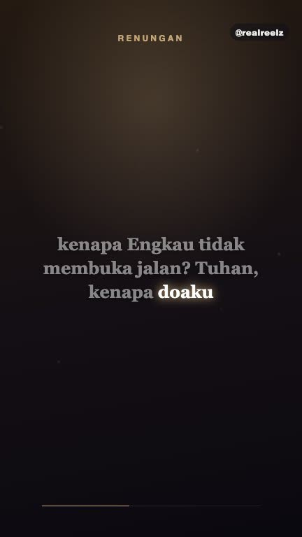<br>**reflective**<br><sub>quotes & reflection</sub> | 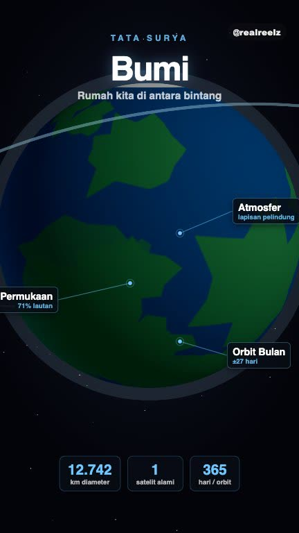<br>**planet**<br><sub>3D diagram (Three.js)</sub> | 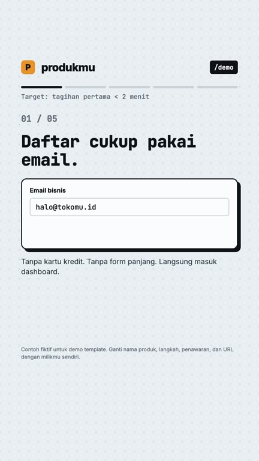<br>**lead**<br><sub>content-lead product walkthrough</sub> | |

Also included: `youtube-psych` (16:9 long-form documentary, `npm run render:yt`)
and `ClippedReel` (the YouTube clipper output).

## How it works

```
topic ──► generate-content (Claude API) ──► src/content.json
                                                │
          tts:edge | tts:eleven | tts ◄─────────┤  narration text
                 │                              │
          public/voiceover.wav ──► captions (whisper.cpp) ──► public/captions.json
                                                │
                       remotion render ◄────────┘  template + scenes + cues
                              │
                        out/reel.mp4
```

| Command | What it does |
|---|---|
| `npm run tts:edge` | Voiceover with edge-tts (default, free). `npm run tts:edge list` shows voices. |
| `npm run tts:eleven` | Voiceover with ElevenLabs (needs `ELEVENLABS_API_KEY`). |
| `npm run tts` | Voiceover with Piper (offline). |
| `npm run captions` | Word-level captions from the voiceover. |
| `npm run render` | Render `src/content.json` to `out/reel.mp4`. |
| `npm run studio` | Live preview in Remotion Studio. |
| `npm run web` | Prompt-to-video web app. |
| `npm run clip <url>` | YouTube to vertical clip with captions. |

## Configuration

All settings live in `.env` (see [.env.example](.env.example)):

| Variable | Purpose |
|---|---|
| `REMOTION_HANDLE` | Default handle on watermarks and outro cards. A content file can override it with `"watermark"`. |
| `ANTHROPIC_API_KEY` | Script generation for the web app and `npm run generate`. |
| `ANTHROPIC_MODEL` | Optional model override for the generator. |
| `EDGE_VOICE` | edge-tts voice, e.g. `id-ID-ArdiNeural`, `en-US-AriaNeural`. |
| `ELEVENLABS_API_KEY`, `ELEVEN_VOICE_ID` | Only if you use ElevenLabs. |
| `CHROME_PATH` | Browser for rendering. Defaults to Google Chrome on macOS, else Remotion's bundled browser. |

Background music is not bundled: drop a royalty-free track at `public/music.mp3`.

Full Indonesian documentation, including template authoring notes and clipper
options, is in [README.id.md](README.id.md).

## Contributing

Bug reports, new templates and translations are welcome. Read
[CONTRIBUTING.md](CONTRIBUTING.md) to get started.

## License and responsible use

The code is released under the [MIT License](LICENSE). Note that:

- **Remotion** has its own license: free for individuals and companies of up to
  3 people, larger for-profit companies need a [company license](https://remotion.dev/license).
- **edge-tts** uses an unofficial Microsoft endpoint that may change at any time.
  ElevenLabs' free tier is non-commercial.
- **The clipper** downloads other people's videos. Only clip content you have
  permission to use, and follow YouTube's Terms of Service.
- The `src/content-*.json` files are example scripts from the author's channels.
  Use them as format references and write your own for publishing.

## Acknowledgements

Built on [Remotion](https://remotion.dev), [whisper.cpp](https://github.com/ggerganov/whisper.cpp),
[edge-tts](https://github.com/rany2/edge-tts), [Piper](https://github.com/rhasspy/piper),
[yt-dlp](https://github.com/yt-dlp/yt-dlp) and [Three.js](https://threejs.org).
